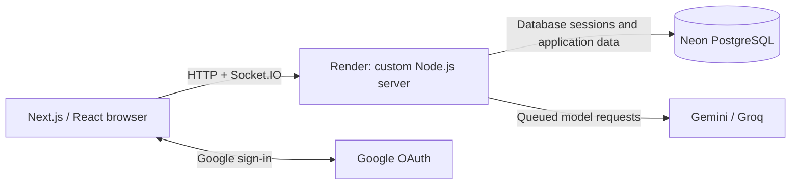

# AgentRoom

**A multiplayer AI workspace for teams, conversations, and shared artifacts.**

[Live Demo](https://agentroom-m6aa.onrender.com) · [GitHub Repository](https://github.com/leslie406prime/AgentRoom)

Built with Next.js, TypeScript, Socket.IO, and PostgreSQL. Development began on **October 26, 2026**, with a public deployment running on Render Free and Neon Free by **November 1, 2026**.

[Overview](#overview) · [Features](#features) · [Screenshots](#screenshots) · [Architecture](#architecture) · [Local development](#local-development) · [Production deployment](#production-deployment) · [Testing](#testing) · [Current limitations](#current-limitations) · [Roadmap](#roadmap)

## Overview

AgentRoom brings teammates and AI agents into shared channels. Members can discuss a project, request an approved AI model, ask Muse to summarize the conversation, and develop shared Markdown or code artifacts alongside the chat.

Workspaces define the access boundary. Creating a workspace makes you its owner; joining someone else's workspace requires an invitation. REST endpoints and Socket.IO actions check membership and permissions on the server. A channel or room URL alone does not grant access to an established workspace.

Messages, completed AI responses, artifacts, and version history persist in the database. Invited members can read existing channel history after joining; reconnecting clients restore a snapshot and replay persisted events.

## Features

- **Google authentication:** Auth.js with database-backed sessions, production secure cookies, and session checks on socket connections and actions. Accounts are never automatically merged by email.
- **Workspaces and invitations:** Create and manage workspaces, invite teammates, transfer ownership, and manage membership. Invitations support expiry, use limits, revocation, and optional verified-email restrictions.
- **Role-based permissions:** Owners manage workspace settings, roles, ownership, and AI policy. Admins manage channels, invite members, remove members within their role limits, and moderate messages. Members can chat, request approved AI agents, and edit artifacts.
- **Channel management:** Create, rename, archive, and delete non-general channels with server-side role checks. Archived channels are read-only; the general channel is protected.
- **Real-time collaboration:** Socket.IO delivers shared messages, presence, AI output streams, queue updates, and artifact events through the same server as the web app.
- **Gemini and Groq integrations:** Official SDK adapters stream responses from workspace-approved models. Agent/model selection is available in the sidebar and composer, with supported mentions such as `@Gemini`, `@Groq`, and `@Muse`.
- **Muse assistant:** A persona powered by an owner-selected Gemini or Groq model, using bounded recent channel history and artifact excerpts to summarize discussions, extract decisions and action items, compare answers, and create shared Markdown documents. Muse is not a separate foundation model and needs no separate API key.
- **Shared artifacts:** Markdown and code editing, immutable version history, restore actions, and optimistic version-conflict checks.
- **Durable persistence:** PostgreSQL for the public deployment, including sessions and uploaded avatar bytes; SQLite remains available for local development.
- **AI queue and recovery:** One running AI job per channel, durable FIFO ordering, usage reservations, PostgreSQL worker leases, and restart recovery. Expired in-flight production jobs are marked interrupted for manual retry rather than automatically repeating an uncertain provider call.
- **Workspace AI controls:** Owners approve models, select defaults and Muse's model, and configure request/token limits. Permissions and quotas are checked when jobs are queued and executed. Usage records include provider/model, token counts when available, and estimates otherwise; they are not provider billing reconciliation.

## Screenshots

Product screenshots have not yet been added to the repository. Suggested captures:

| Screenshot to add | What it should show |
| --- | --- |
| Workspace and channel view | Channel sidebar, shared conversation, and artifact panel |
| AI collaboration | Agent selection, a streamed response, and Muse's channel summary |
| Workspace administration | Invitations, member roles, and model permissions |
| Artifact history | Version selection and conflict handling |

Use a demonstration workspace and redact private conversations, member details, and credentials before adding images. No fabricated screenshots are included.

## Architecture

| Layer | Implementation |
| --- | --- |
| Frontend | Next.js 15 App Router, React 19, TypeScript, Tailwind CSS; Monaco for code artifacts |
| Backend | One custom Node.js server hosting Next.js, Socket.IO, and AI queue workers |
| Authentication | Auth.js with Google OAuth and a custom database adapter |
| Database | SQLite/WAL locally; pooled Neon PostgreSQL with certificate-verified TLS in production |
| AI | Google Gemini via `@google/genai`; Groq via `groq-sdk` |
| Deployment | Render Free Node web service + Neon Free PostgreSQL |



Server repositories enforce workspace/channel scope and persist sequenced collaboration events. A shared async database layer supports SQLite and PostgreSQL. PostgreSQL startup checks connectivity and applies versioned, checksum-checked migrations before listening; graceful shutdown drains workers and closes clients.

Key implementation entry points: [server.ts](server.ts), [authentication](src/auth.ts), [permissions](src/server/permissions.ts), [workspace repository](src/server/workspace-repository.ts), [collaboration repository](src/server/collaboration-repository.ts), and [AI queue](src/server/queue.ts).

## Local development

### Prerequisites and installation

Use **Node.js 22** (see [.node-version](.node-version)), npm, and Git. SQLite requires the `better-sqlite3` native dependency; systems without a compatible prebuilt binary need their platform's native build tools. PostgreSQL is optional for ordinary local development.

```bash
git clone https://github.com/leslie406prime/AgentRoom.git
cd AgentRoom
npm ci --include=dev
```

For a **new installation**, copy [.env.example](.env.example) to `.env.local` (`cp .env.example .env.local` on macOS/Linux, or `Copy-Item .env.example .env.local` in PowerShell). Edit an existing file in place instead of overwriting it. Environment variables inherited by the process take precedence over `.env.local`, which takes precedence over `.env`.

### Environment configuration

| Variable | Local configuration |
| --- | --- |
| `AUTH_SECRET` | A stable random value of at least 32 characters; generate one for a new installation only |
| `AUTH_URL` | `http://localhost:3000` |
| `AUTH_GOOGLE_ID`, `AUTH_GOOGLE_SECRET` | Your Google OAuth web-client values |
| `GEMINI_API_KEY`, `GROQ_API_KEY` | Server-side AI provider keys; configure the providers you intend to use |
| `AUTH_MOCK_OAUTH_ENABLED` | `false` for real Google login; `true` only for isolated local mock login |
| `DATABASE_URL` | Leave empty for local SQLite; set a private PostgreSQL URL to use PostgreSQL |
| `DATABASE_PATH` | `./data/agentroom.sqlite` by default |
| `AVATAR_DIRECTORY` | `./data/avatars` for local SQLite uploads |
| `PORT` | `3000` by default |

For a new installation, generate an auth secret with:

```bash
node -e "console.log(require('node:crypto').randomBytes(32).toString('base64url'))"
```

Keep credentials server-side and outside Git; never use a `NEXT_PUBLIC_` prefix for secrets. Preserve existing secrets and database files. Optional OpenAI support exists behind explicit owner authorization and model/usage controls; `OPENAI_API_KEY`, `OPENAI_MODEL`, and the optional `WORKSPACE_CREDENTIAL_KEY` are documented in `.env.example`. They are not required for Gemini, Groq, or Muse, and the free deployment does not require enabling paid providers.

### Google OAuth setup

1. Create or select a Google Cloud project and configure its OAuth consent screen.
2. Create a **Web application** OAuth client. Register `http://localhost:3000/api/auth/callback/google` as an authorized redirect URI and the local origin if required by your client configuration.
3. Put the client values in `AUTH_GOOGLE_ID` and `AUTH_GOOGLE_SECRET`. If the OAuth app is in testing mode, add the intended accounts as test users.
4. Keep `AUTH_MOCK_OAUTH_ENABLED=false` for real sign-in. For credential-free local UI development, mock login can be enabled explicitly outside production; mock identities do not exercise Google.

### Database and startup

```bash
npm run dev
```

Open [localhost:3000](http://localhost:3000). The server initializes a new local SQLite database and applies its ordered migrations automatically. No database reset or manual SQL bootstrap is needed. Existing SQLite records remain local; a fresh production PostgreSQL database does not require importing them. Never run `npm run reset` against data you want to retain.

After signing in, create a workspace, invite a teammate, and open a channel. Owners can configure **Workspace settings → AI agents and models** to approve models, select defaults and Muse's model, and set limits. Availability depends on configured keys and provider access. Explicitly labeled local demo responses are available when no approved model is available; they are not real AI generation. Provider failures are not silently replaced with fake replies or a different model.

See [Testing](#testing) for local verification commands.

## Production deployment

The public application runs at **[agentroom-m6aa.onrender.com](https://agentroom-m6aa.onrender.com)** on **Render Free + Neon Free**. The deployed server connects to PostgreSQL; it does not rely on Render's ephemeral filesystem for application records or uploaded avatars. Production startup requires `DATABASE_URL` and refuses SQLite fallback.

Follow the [Render + Neon release runbook](docs/RENDER_NEON_RELEASE.md) for setup and acceptance checks, [PostgreSQL verification](docs/POSTGRES_READINESS.md) for local persistence evidence, and [startup diagnostics](docs/STARTUP_DIAGNOSTICS.md) for safe troubleshooting. Some runbook gates and older audit documents describe earlier release stages; they are historical checklists, not proof that a current feature is missing.

| Render setting | Value |
| --- | --- |
| Build command | `npm ci --include=dev && npm run build` |
| Start command | `npm start` |
| Health check | `/api/health` |
| Runtime | Node.js 22; one instance |

Keep development dependencies installed: `tsx` and `cross-env` are used at runtime. Use the custom server rather than `next start`. Render supplies `PORT`; the server binds on `0.0.0.0`.

Set these **server-side** variables privately in Render:

| Variable | Value or placeholder |
| --- | --- |
| `NODE_ENV` | `production` |
| `AUTH_URL` | `https://agentroom-m6aa.onrender.com` for this deployment |
| `AUTH_SECRET` | `<stable-random-secret>` |
| `AUTH_GOOGLE_ID`, `AUTH_GOOGLE_SECRET` | `<google-client-id>`, `<google-client-secret>` |
| `DATABASE_URL` | `<private-pooled-neon-postgresql-url>` with TLS |
| `AUTH_MOCK_OAUTH_ENABLED` | `false` |
| `GEMINI_API_KEY`, `GROQ_API_KEY` | `<provider-key>` for each enabled provider |

Register `https://agentroom-m6aa.onrender.com/api/auth/callback/google` in the matching Google OAuth client. Set `AUTH_URL` consistently at build and runtime because the content security policy includes the application origin. Leave test/build-only flags unset at runtime.

The initial deployment uses a fresh, empty PostgreSQL database. Startup applies the schema transactionally and refuses an unrecognized non-empty schema; do not reset an existing database to bypass that check. No historical SQLite migration or upload is required.

Render Free can sleep when idle, restart, and impose resource/usage limits; the first visit can take longer while it wakes. Neon compute can also require a cold start. Neither free hosting nor free AI quotas provide an availability guarantee. Consult the current [Render Free limits](https://render.com/docs/free) and [Neon plans](https://neon.com/docs/introduction/plans) before changing hosting settings.

## Testing

| Command | Coverage |
| --- | --- |
| `npm test` | Vitest unit/repository tests with in-memory SQLite: permissions, invitations, authentication boundaries, queues, usage, provider routing, Muse, artifacts, and migrations |
| `npm run test:postgres` | Fresh isolated local PostgreSQL: schema, async repositories, authorization, sessions, mock AI queue/usage, worker leases, avatar bytes, Google OIDC regressions, restart persistence, and FIFO recovery |
| `npm run test:e2e` | Playwright browser flows with isolated SQLite, mock OAuth, and external provider keys cleared |
| `npm run test:ui` | Two-browser channel creation and agent selection using SDK adapters with mocked provider HTTP streams |
| `npx tsc --noEmit` | TypeScript checks |
| `npm run lint` | ESLint |
| `npm run build` | Production Next.js build |
| `npm run check:secrets` | Production browser-bundle secret scan; run after building |
| `npm run check:staged` | Staged-file secret/data scan; run after staging changes |

Install Chromium with `npx playwright install chromium` before browser tests. The standard browser harness requires port 3000 to be available; stop a conflicting development server yourself before running it. PostgreSQL tests create and stop disposable local clusters, not a Neon production database, and must never be pointed at production credentials.

Additional [Google OIDC regression fixtures](tests/postgres/google-oidc-flow.ts) exercise first-time signup, returning login, separate Google identities, cross-user linking refusal, explicit linking-intent requirements, and rejection of email-based merging. The [compiled production HTTP fixture](tests/postgres/google-http.cjs), described in the [authentication investigation](docs/GOOGLE_SIGN_IN_INVESTIGATION.md), tests the real application routes with mocked Google discovery, token, and signing-key responses.

**Automated OAuth tests do not use real Google credentials.** Real Google login on the public deployment has been manually verified, as reported by the maintainer; that is separate from automated test coverage. The investigation document records an earlier login failure and the diagnostics added at that time.

Opt-in `npm run test:live` and `npm run test:live:app` use configured Gemini/Groq keys and consume provider quota. The latter exercises real AI through the UI in an isolated application process on port 3101; its login is still mocked. These tests are not part of ordinary offline verification. Passing mocks or listing models does not establish live provider availability. See [AI runtime diagnostics](docs/AI_RUNTIME_DIAGNOSTICS.md) for provider troubleshooting.

## Current limitations

- **Single application instance.** Socket delivery, presence, and some rate/provider guards are process-local. PostgreSQL leases do not make the application ready for horizontal scaling.
- **Workspace-wide channels.** Private-channel membership and permissions are not implemented.
- **Artifact concurrency.** Editing uses optimistic version checks and conflict handling, not simultaneous CRDT/OT collaboration.
- **Bounded Muse context.** Muse reads recent channel history and selected artifact excerpts, not the entire historical archive. It can make errors and does not create durable task-management records or provide full-text history search.
- **Limited identity recovery.** Google connect/disconnect controls exist, require explicit linking intent, and protect the final identity. There is no self-service cross-provider recovery or automatic account merging; Google is the only real sign-in provider.
- **Incomplete moderation workflow.** Owner/admin message deletion exists; abuse reporting and a moderation review workflow do not.
- **Transient live state.** Presence and active stream chunks are ephemeral. Persisted messages, artifacts, jobs, and replay events survive restarts; interrupted external calls cannot be guaranteed exactly once.
- **Free-tier constraints.** Render cold starts and resource limits, Neon compute/storage quotas, and AI provider quotas/model eligibility affect availability. Usage estimates are not a billing ledger, and local test results do not establish production load capacity.

## Roadmap

Planned improvements, not implemented commitments:

- Broaden supported AI providers and model configuration.
- Improve Muse's retrieval, context visibility, and task-oriented assistance.
- Add collaborative artifact editing beyond optimistic conflict resolution.
- Develop abuse reporting and moderation review tools.
- Improve deployment observability and operational diagnostics.
- Introduce shared real-time infrastructure and distributed coordination for scalability.
